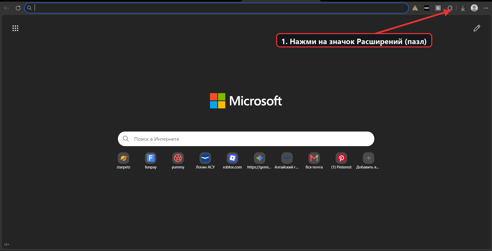
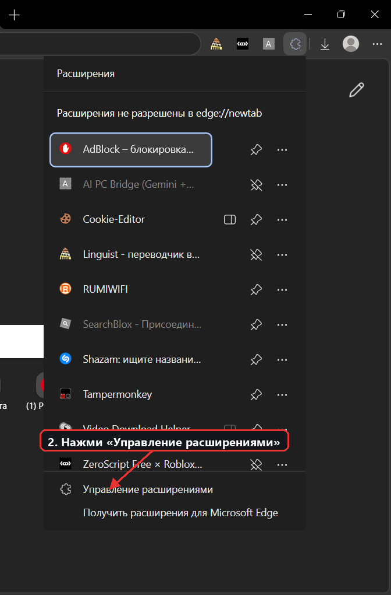
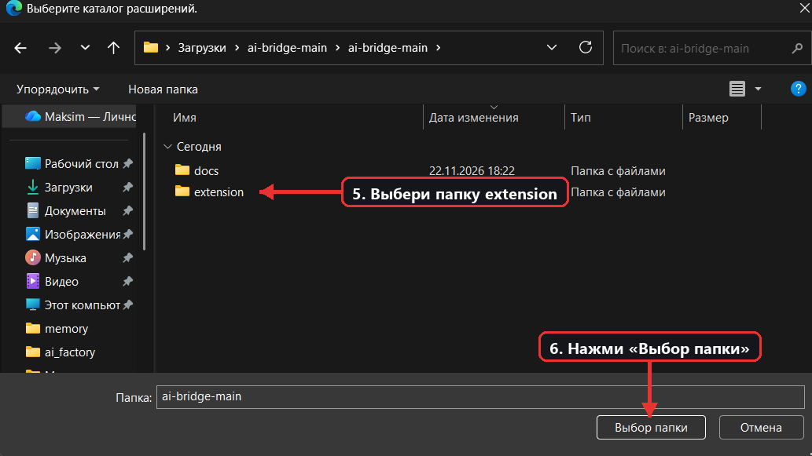

# 🚀 AI Bridge — Управление Windows через ИИ (Microsoft Edge)

   

Локальный мост между браузером **Microsoft Edge** (чат с Gemini или DeepSeek) и твоим ПК на Windows. Позволяет ИИ запускать программы, работать с файлами, выполнять команды в консоли, управлять окнами, буфером обмена и делать скриншоты.

> 💡 **Основной браузер:** проект рассчитан и протестирован в первую очередь для **Microsoft Edge** (также работает в других Chromium-браузерах).

---

## 📦 Пошаговая установка в Microsoft Edge

### Шаг 1. Скачай проект и запусти сервер (`start.bat`)
1. Скачай **`ai-bridge-v6.1.zip`** из раздела **[Releases](https://github.com/FANI123-PNG/ai-bridge/releases/latest)** (или через **Code → Download ZIP**) и распакуй в любую папку.
2. Запусти **`start.bat`** двойным кликом — скрипт сам проверит Python, установит недостающие библиотеки из `requirements.txt` и запустит локальный сервер на `http://127.0.0.1:8000`.

---

### Шаг 2. Открой «Новая вкладка» в Microsoft Edge и перейди в Расширения
1. Открой **Microsoft Edge** и нажми **`+` (Новая вкладка)**.
2. В правом верхнем углу панели браузера нажми на значок **Расширения (пазл)**.

3. В открывшемся списке нажми **Управление расширениями** в самом низу.

---

### Шаг 3. Включи «Режим разработчика» и загрузи папку `extension`
1. **Обязательно включи тумблер «Режим разработчика»** в левом нижнем углу панели (без него кнопка загрузки распакованных расширений будет скрыта).
2. После этого сверху появится кнопка **Загрузить распакованное** — нажми на неё.

3. В открывшемся окне проводника выбери папку **`extension`** внутри распакованного проекта и нажми **Выбор папки**.

---

### Шаг 4. Активируй мост в чате и пиши задачи
1. Открой вкладку с **Gemini** или **DeepSeek** в Microsoft Edge (если вкладка уже была открыта — обнови её через **`F5`**).
2. В правом нижнем углу экрана появится кнопка **`⚡ PC Bridge`** — нажми на неё, чтобы отправить системный промпт подключения в чат (ИИ ответит `⚡ Мост подключён. Готов управлять ПК.`).
3. После этого пиши любые задачи обычным языком — когда ИИ выведет JSON-команду, расширение выполнит её на ПК и вернёт отчёт со значком **`⚡`**.

---

## 🛠 Возможности моста (`bridge.py` v6.1)

- **Программы и окна:** запуск приложений и ярлыков (`open_app`), закрытие процессов (`kill_app`), управление окнами (`window`).
- **Файлы и скрипты:** чтение/запись файлов (`read_file`, `write_file`), мгновенный запуск Python-скриптов (`extra="run"`).
- **Тихий терминал (`CREATE_NO_WINDOW`):** выполнение команд CMD и PowerShell без всплывающих чёрных окон.
- **Пакетные цепочки (`batch`):** выполнение нескольких действий подряд за один ответ нейросети.
